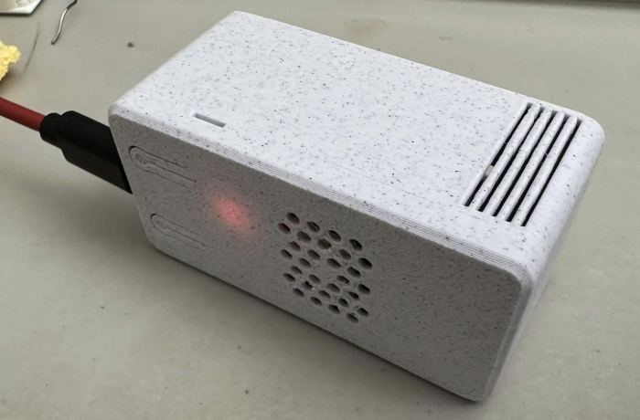
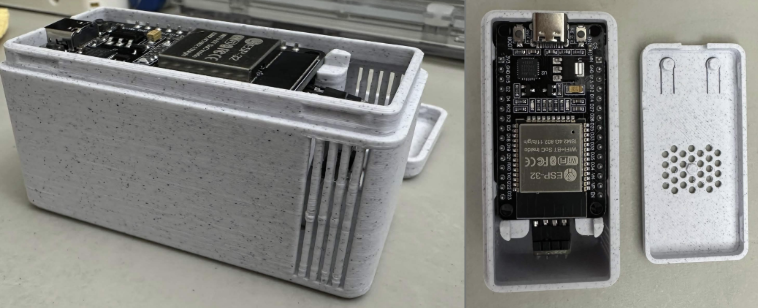
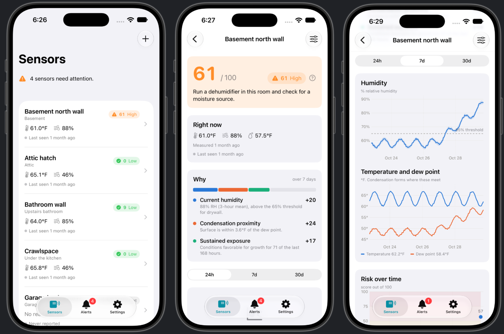
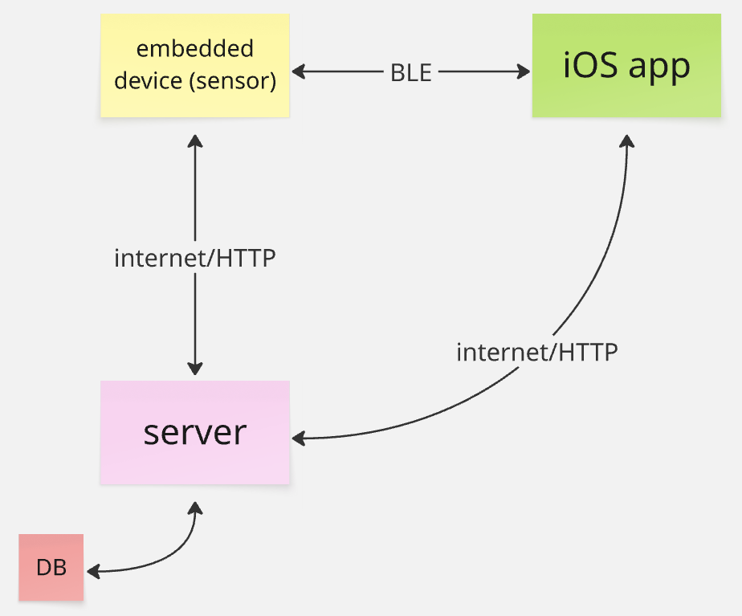

# Flood

Flood is a small humidity/temperature sensing device and iOS app that allows users to track indoor mold-risk metrics. Readings are turned into mold-risk calculations automatically, and users are notified of sustained high-risk conditions through push notifications. A web server allows you to connect multiple devices and manage more than one user.

## Features

### Hardware


<br>


The hardware to Flood is a small, USB-C powered box that is placed in a damp condition prone area (basement, crawlspace, attic, under sink), and constantly monitors humidity/temperature data. 

Setup is simple: the device connects to the app over Bluetooth for WiFi configuration, and then is left unattended. A web server receives the updates and can send notifications to your phone and record mold risk history.

**Parts list**

| Part | Qty | Notes |
|---|---|---|
| ESP32 dev board (30-pin, ESP-WROOM-32, USB-C) | 1 | |
| SHT31-D temperature/humidity sensor | 1 | I2C |
| Female-to-female jumper wires | 4 | |
| USB-C cable + 5V USB power adapter | 1 | |
| 3D-printed case | 1 | [Case files](https://makerworld.com/en/models/2291718-esp32-wroom-case-snap-fit-parametric#profileId-2500609) |

### iOS app & server



Each risk score comes with a breakdown of the factors contributing to it, and a suggested action for the user.

## How it works

Flood has three parts that work together, all of which need to be set up before the system can run. The physical device sends its readings over WiFi to the server, which calculates the mold risk and sends alerts to the iOS app.

### Architecture



**Sensor/Physical device:** An SHT31 temperature/humidity sensor is wired to an ESP32 board, which are both enclosed in a 3D-printed case. There are no buttons, and the device only needs to be paired once initially through Bluetooth. A reading is taken every 30 seconds and uploaded to the server in batches every 5 minutes. A buffer of roughly 1 day of readings are held in case the WiFi or server goes down.

**Server:** The server is written in Node.js using Fastify, and stores everything in a SQLite database. A mold-risk score is calculated from 0-100 from the past week of readings by looking at how far the conditions are from dew point, the humidity, and the length of the conditions. A push alert is sent once risks are high. The sensor surface is also taken into account (e.g., drywall grows mold faster than concrete)

**iOS app:** Written in SwiftUI. Users can set up and name multiple sensors. For each sensor, the risk score and colored charts of its readings are displayed. The app receives the push notifications, and an alert history is also provided.

## Running the server

```sh
npm install
JWT_SECRET=<any-long-random-string> npm start
```

## Trying it without hardware

```sh
npm run seed              # a week of fake history
npm run feed              # optional: (keeps sending live readings)
open ios/Flood.xcodeproj  # then Run
```

## Setting up a real sensor

1. **Wire it**

   | SHT31 | ESP32 |
   |---|---|
   | VIN | 3V3 |
   | GND | GND |
   | SDA | GPIO 21 |
   | SCL | GPIO 22 |

2. **Register the device with the server**
   - Run `npm run provision:firmware` from the repo root
   - This adds the sensor to the servers database and writes an ID and secret key to `firmware/flood/device_identity.h`, which is complied into firmware

3. **Flash the firmware**

   Open `firmware/flood/flood.ino` and upload it.

   The ESP32's default partition scheme is too small for the firmware, so it needs to be switched to **Minimal SPIFFS** before uploading:
   - **Arduino IDE:** Tools → Partition Scheme → **Minimal SPIFFS**
   - **arduino-cli:**
     ```sh
     arduino-cli compile --upload -p <port> \
       --fqbn esp32:esp32:esp32:PartitionScheme=min_spiffs firmware/flood
     ```
     (`<port>` is the board's USB port, e.g. `/dev/cu.usbserial-0001`)

4. **Connect the device to the app**

   Using a physical phone, find and press **"Add sensor"** on the app. The sensor will be found over Bluetooth. Then enter your WiFi network and password. Once pairing is finished, Bluetooth turns off and readings start appearing.

## Tests

```sh
npm test
```

Server tests run on an in-memory database, so you don't need the server running. The iOS tests run from Xcode with ⌘U.

## Credits and AI Disclosure

The case was modeled by i-BoxIt: [link here](https://makerworld.com/en/models/2291718-esp32-wroom-case-snap-fit-parametric#profileId-2500609).

I used Claude Code to assist with writing the software for this project.